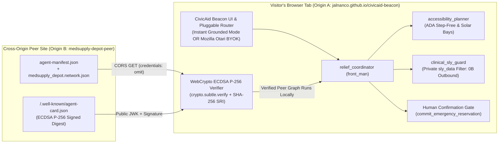

# CivicAid Beacon — Open Agentic Web Humanitarian Triage Mesh & `@civicaid/beacon-kit`

[](./LICENSE)
[](https://github.com/cognizant-ai-labs/agentic-web)
[](./docs/.well-known/agent-card.json)

**CivicAid Beacon** is a zero-server, cryptographically verified Open Agentic Website built for the **Open Agentic Web Challenge** (Cognizant AI Lab × MIT Media Lab NANDA × Mozilla Otari × AWS).

During natural disasters and grid outages, local shelters and emergency medical supply depots publish static status pages on separate domains without shared backend servers. **CivicAid Beacon** enables evacuees and relief coordinators to compose multi-agent shelter triage and cross-origin solar cold-chain medical supply checks **100% inside a standard browser tab**—while keeping sensitive patient medical data (`sly_data`) and Bring-Your-Own-Key (BYOK) LLM credentials strictly inside the caller's browser.

---

## Live Public Deployments (CORS `*` Enabled)

1. **Caller & Workbench Site (`civicaid_shelter_hub`)**:
   - **Live Web App**: `https://jalnanco.github.io/civicaid-beacon/`
   - **Agent Manifest**: `https://jalnanco.github.io/civicaid-beacon/agent-manifest.json`
   - **Resolved Network Graph**: `https://jalnanco.github.io/civicaid-beacon/civicaid_shelter_hub.network.json`
   - **MIT NANDA / A2A Signed Card**: `https://jalnanco.github.io/civicaid-beacon/.well-known/agent-card.json`
2. **Independent Peer Agentic Website (`medsupply_depot`)**:
   - **Live Peer Site**: `https://jalnanco.github.io/medsupply-depot-peer/` ([GitHub Repo](https://github.com/jalnanco/medsupply-depot-peer))
   - **Cross-Origin Peer Artifact Endpoint**: `https://raw.githubusercontent.com/jalnanco/medsupply-depot-peer/main/docs/medsupply_depot`
   - **Peer NANDA Signed Card**: `https://jalnanco.github.io/medsupply-depot-peer/.well-known/agent-card.json`

---

## Architecture & Spec Conformance (`MVP Profile 0.2` + `MIT NANDA`)



### Key Capabilities Demonstrated
- **Tenet 1 — Declarative Multi-Agent JSON**: Pure resolved Neuro SAN-compatible `.network.json` with zero server-side `include` directives, zero `${ENV}` substitutions, and strict JSON Schema parameters.
- **Tenet 2 — Browser Execution, Consent & Human-Owned Writes**:
  - Explicit **Cross-Origin Peer Consent Dialog** before contacting external origins.
  - Explicit **Mutating Site Action Confirmation Dialog** (`commit_emergency_reservation`) with optimistic `stateVersion` concurrency checks and SHA-256 dispatch receipts.
  - Origin-isolated `bridge/action-bridge.html` passing the official `check_partner.mjs` check with **0 errors**.
- **Tenet 3 — Pluggable Inference (`Instant Judge Mode` + `Mozilla Otari BYOK`)**:
  - Works out-of-the-box with **zero API keys** via the deterministic grounded browser planner, and switches seamlessly to **Mozilla Otari** (`https://api.otari.ai/api/v1`, `alibaba/qwen3.8-flash`) or any OpenAI-compatible CORS router with credentials isolated in `localStorage`.
- **MIT NANDA Cryptographic Identity (`/.well-known/agent-card.json`)**:
  - Every published `agent-manifest.json` and `.network.json` is pinned by canonical SHA-256 SRI digests and signed with an ECDSA P-256 keypair verified in `<1 ms` via native browser `window.crypto.subtle`.
- **Reusable Community Toolkit (`docs/kit/`)**:
  - `conformance-auditor.mjs`: Zero-dependency ES module auditing any URL against 12 Open Agentic Web + NANDA checks.
  - `nanda-verifier.mjs` & `tools/generate_nanda_cards.mjs`: Reusable WebCrypto ECDSA P-256 signer and verifier for static sites.

---

## Quickstart & Automated Verification

Requires Node.js 20+ (tested on Node v26) or Python 3 for static serving:

```bash
# 1. Re-sign /.well-known/agent-card.json digests and run the 5-suite automated test suite
node tools/generate_nanda_cards.mjs
node --test tests/conformance.test.mjs

# 2. Serve locally and open http://127.0.0.1:8080
python3 -m http.server 8080 --directory ./docs
```

---

## License & Open-Source Notice

- **CivicAid Beacon & `@civicaid/beacon-kit`**: Released under the [MIT License](./LICENSE).
- **Reference Interoperability Bridge (`docs/runtime/`)**: Includes unmodified browser bridge modules from [`cognizant-ai-labs/agentic-web`](https://github.com/cognizant-ai-labs/agentic-web) under the Apache License 2.0 (`docs/runtime/LICENSE.txt`).
